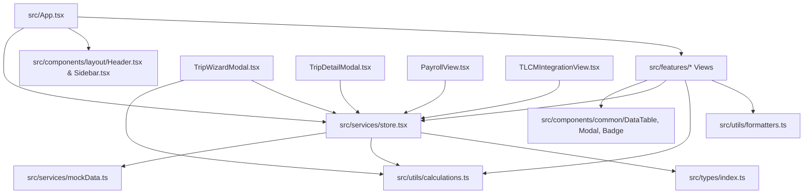

# Repository Map: Trip Sheet Management System

## 1. Directory Tree & File Structure

```
c:\Trip_sheet\trip_sheet\
│   .env.example                  # Environment variable template
│   .gitignore                    # Git ignore file
│   bun.lock                      # Bun lockfile
│   index.html                    # Single-page application root HTML
│   metadata.json                 # Google AI Studio project metadata
│   package.json                  # NPM dependencies & build scripts
│   tsconfig.json                 # TypeScript compiler configuration
│   vite.config.ts                # Vite build and plugin setup
│
├── docs/                         # Architecture and audit documentation
│   └── architecture-audit/       # 16 Comprehensive Audit & Architecture Documents
│
├── public/                       # Static public assets
│
└── src/                          # Application source code
    │   App.tsx                   # Main application layout, navigation & view switcher
    │   index.css                 # Base Tailwind CSS imports & theme overrides
    │   main.tsx                  # React 19 application mounting entry point
    │
    ├── components/               # Shared reusable UI elements
    │   ├── common/
    │   │   ├── Badge.tsx         # Unified status badge (active, draft, synced, etc.)
    │   │   ├── ConfirmDialog.tsx # Modal confirmation dialog for critical actions
    │   │   ├── DataTable.tsx     # Generic searchable, sortable table with pagination
    │   │   ├── Modal.tsx         # Responsive modal dialog wrapper
    │   │   └── StatCard.tsx      # Metric display cards with trend indicators
    │   └── layout/
    │       ├── Header.tsx        # Top navigation header with user profile & notifications
    │       └── Sidebar.tsx       # Collapsible left navigation bar with module routes
    │
    ├── features/                 # Domain-driven feature views and modals
    │   ├── advances/
    │   │   └── AdvanceListView.tsx           # Advance ledger, issuance & return dialogs
    │   ├── audit/
    │   │   └── AuditLogView.tsx              # System audit trail viewer & filter
    │   ├── dashboard/
    │   │   └── DashboardView.tsx             # Fleet overview KPI cards, charts & quick actions
    │   ├── drivers/
    │   │   ├── CreateDriverModal.tsx         # Driver registration modal form
    │   │   ├── DriverDetailModal.tsx         # 8-tab comprehensive driver profile & ledger
    │   │   └── DriverListView.tsx            # Driver directory table
    │   ├── expenses/
    │   │   └── TripExpenseApprovalView.tsx   # Fleet-wide expense auditing & approvals
    │   ├── fuel-deductions/
    │   │   └── FuelDeductionsView.tsx        # Fuel deduction auditing, waivers & adjustments
    │   ├── fuel-topups/
    │   │   └── FuelTopUpListView.tsx         # Bunkering logs, top-up modal & vehicle odo sync
    │   ├── integrations/
    │   │   ├── IntegrationLogsView.tsx       # TLCM Pro event queue log viewer
    │   │   └── TLCMIntegrationView.tsx       # TLCM Pro integration gateway dashboard
    │   ├── mileage-benchmarks/
    │   │   └── BenchmarkListView.tsx         # Vehicle type & vehicle mileage benchmarks
    │   ├── payroll/
    │   │   └── PayrollView.tsx               # Monthly payroll generator & finalization seal
    │   ├── payslips/
    │   │   └── PayslipView.tsx               # Printable driver payslips with full itemization
    │   ├── salary-structures/
    │   │   └── SalaryStructureView.tsx       # Salary package creator & driver assignment
    │   ├── settings/
    │   │   ├── SettingsView.tsx              # Global settings, fuel price, tolerance, TLCM URL
    │   │   └── UsersPermissionsView.tsx      # User directory and RBAC permission overview
    │   ├── settlements/
    │   │   └── SettlementListView.tsx        # Advance reconciliation & return tracking
    │   ├── trips/
    │   │   ├── TripDetailModal.tsx           # Trip sheet inspector with section tabs
    │   │   ├── TripListView.tsx              # Trip directory table & filters
    │   │   └── TripWizardModal.tsx           # 8-step full operational trip creation wizard
    │   └── vehicles/
    │       └── VehicleReferenceView.tsx      # TLCM Pro vehicle master mirror table
    │
    ├── services/                 # Central reactive state and mock dataset
    │   ├── mockData.ts           # Comprehensive seed data for fleet simulation
    │   └── store.tsx             # React Context store (FleetStoreProvider) & local persistence
    │
    ├── types/                    # Enterprise TypeScript interfaces & enums
    │   └── index.ts              # Data models for all business domains
    │
    └── utils/                    # Core business logic and presentation helpers
        ├── calculations.ts       # Odometer, fuel, deduction, and settlement calculations
        └── formatters.ts         # Currency (INR), distance (km), fuel (L), and dates
```

---

## 2. Application Entry Points & Bootstrapping

1. **`index.html`**:
   * HTML5 entry container (`<div id="root"></div>`).
   * Loads Google Fonts: `Inter` (sans) and `JetBrains Mono` (mono).
   * Script module source: `/src/main.tsx`.
2. **`src/main.tsx`**:
   * Initializes React 19 root: `createRoot(document.getElementById('root')!).render(<StrictMode><App /></StrictMode>)`.
3. **`src/App.tsx`**:
   * Top-level component wrapping everything in `<FleetStoreProvider>`.
   * Manages navigation state via `currentPage: PageId`.
   * Houses the responsive shell: `<Sidebar />`, `<Header />`, and dynamic view switcher `<FleetAppContent />`.

---

## 3. Core Libraries & Dependencies

| Library | Version | Role in Application |
| :--- | :--- | :--- |
| **react** | `^19.0.1` | Core UI rendering engine |
| **react-dom** | `^19.0.1` | DOM bindings for React 19 |
| **vite** | `^8.3.0` | Ultra-fast development server and asset bundler |
| **tailwindcss** | `^4.3.3` | Utility-first styling framework via `@tailwindcss/vite` |
| **lucide-react** | `^0.546.0` | High-quality icon set used across navigation and tables |
| **recharts** | `^3.10.1` | Analytics charts in `DashboardView.tsx` |
| **motion** | `^12.23.24` | Animation primitives for UI transitions |
| **dotenv** / **express** | `^17.2.3` / `^4.21.2` | Present in `package.json` dependencies; unused in client bundle |
| **typescript** | `^7.0.2` | Static type system |

---

## 4. Key Module Interdependencies



All 16 feature modules interact directly with `useFleetStore()`, allowing cross-view reactivity across drivers, vehicles, advances, trips, fuel records, payroll runs, and integration jobs.
