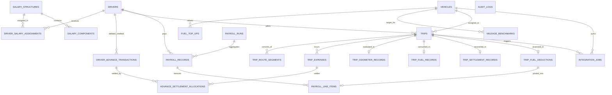

# Proposed PostgreSQL Database Schema

## 1. Schema Design Philosophy

1. **Third Normal Form (3NF) & Relational Integrity**: Unlike the frontend's monolithic JSON `Trip` object, domain attributes are normalized into specialized tables (`trips`, `trip_route_segments`, `trip_expenses`, `trip_fuel_records`, `trip_settlement_records`).
2. **Double-Entry Financial Ledger**: Driver advances and settlements are tracked via immutable ledger transactions rather than direct numeric overwrites.
3. **Effective-Dated Records**: Salary assignments and mileage benchmarks use `effective_from` and `effective_to` timestamp ranges.
4. **Finalized Immutability**: Finalized payroll runs and locked line items are protected by database status checks.
5. **Strict Odometer & Fuel Invariants**: Database check constraints ensure readings and quantities remain physically valid (non-negative, sequential).

---

## 2. Entity-Relationship Diagram (Mermaid)

---

## 3. Detailed Table Specifications

### 3.1 Drivers & Salary Architecture

#### `drivers`
* `id` (UUID, PK, `gen_random_uuid()`)
* `driver_number` (VARCHAR(50), UNIQUE, NOT NULL, e.g. `'DRV-2026-001'`)
* `full_name` (VARCHAR(255), NOT NULL)
* `phone` (VARCHAR(30), NOT NULL)
* `email` (VARCHAR(255), NULL)
* `address` (TEXT, NOT NULL)
* `license_number` (VARCHAR(100), UNIQUE, NOT NULL)
* `license_expiry` (DATE, NOT NULL)
* `joining_date` (DATE, NOT NULL)
* `status` (VARCHAR(30), NOT NULL, CHECK in `'active', 'on_leave', 'suspended', 'resigned', 'terminated'`)
* `current_vehicle_id` (UUID, FK -> `vehicles.id`, NULL)
* `notes` (TEXT, NULL)
* `created_at` / `updated_at` (TIMESTAMPTZ, NOT NULL)

#### `salary_structures`
* `id` (UUID, PK)
* `name` (VARCHAR(150), NOT NULL)
* `code` (VARCHAR(50), UNIQUE, NOT NULL, e.g. `'STD-HEAVY-TRUCK'`)
* `description` (TEXT, NULL)
* `effective_date` (DATE, NOT NULL)
* `is_active` (BOOLEAN, DEFAULT true)
* `created_at` / `updated_at` (TIMESTAMPTZ, NOT NULL)

#### `salary_components`
* `id` (UUID, PK)
* `salary_structure_id` (UUID, FK -> `salary_structures.id` ON DELETE CASCADE)
* `name` (VARCHAR(100), NOT NULL, e.g. `'Basic Salary'`, `'HRA'`, `'Trip Bata'`)
* `category` (VARCHAR(50), NOT NULL, CHECK in `'basic', 'allowance', 'bata', 'statutory_deduction', 'other'`)
* `type` (VARCHAR(20), NOT NULL, CHECK in `'earning', 'deduction'`)
* `calculation_type` (VARCHAR(20), NOT NULL, CHECK in `'fixed', 'percentage'`)
* `amount_or_percentage` (DECIMAL(12, 2), NOT NULL, CHECK >= 0)
* `applicability_rules` (TEXT, NULL)
* `is_active` (BOOLEAN, DEFAULT true)

#### `driver_salary_assignments`
* `id` (UUID, PK)
* `driver_id` (UUID, FK -> `drivers.id`, NOT NULL)
* `salary_structure_id` (UUID, FK -> `salary_structures.id`, NOT NULL)
* `effective_from` (DATE, NOT NULL)
* `effective_to` (DATE, NULL)
* `status` (VARCHAR(20), NOT NULL, CHECK in `'active', 'scheduled', 'expired'`)
* `created_at` (TIMESTAMPTZ, NOT NULL)
* *Index*: `(driver_id, effective_from)`

---

### 3.2 Vehicles & Fuel Top-Ups

#### `vehicles` (Authoritative Cache from TLCM Pro)
* `id` (UUID, PK)
* `tlcm_vehicle_id` (VARCHAR(100), UNIQUE, NOT NULL, e.g. `'TLCM-VEH-081'`)
* `registration_number` (VARCHAR(50), UNIQUE, NOT NULL, e.g. `'TN-04-AB-1234'`)
* `vehicle_type` (VARCHAR(50), NOT NULL)
* `make_model` (VARCHAR(100), NOT NULL)
* `tonnage` (DECIMAL(6, 2), NOT NULL, CHECK > 0)
* `status` (VARCHAR(30), NOT NULL, CHECK in `'active', 'in_maintenance', 'idle', 'decommissioned'`)
* `latest_odometer` (INTEGER, NOT NULL, CHECK >= 0)
* `total_trip_distance` (INTEGER, DEFAULT 0, CHECK >= 0)
* `assigned_tyres_count` (INTEGER, NOT NULL)
* `has_stepney_fitted` (BOOLEAN, DEFAULT true)
* `sync_status` (VARCHAR(30), NOT NULL, CHECK in `'connected', 'last_sync', 'sync_pending', 'sync_failed'`)
* `last_sync_time` (TIMESTAMPTZ, NOT NULL)
* `created_at` / `updated_at` (TIMESTAMPTZ, NOT NULL)

#### `fuel_top_ups`
* `id` (UUID, PK)
* `vehicle_id` (UUID, FK -> `vehicles.id`, NOT NULL)
* `date_time` (TIMESTAMPTZ, NOT NULL)
* `litres` (DECIMAL(10, 2), NOT NULL, CHECK > 0)
* `price_per_litre` (DECIMAL(10, 2), NOT NULL, CHECK > 0)
* `total_cost` (DECIMAL(12, 2), NOT NULL, CHECK > 0)
* `fuel_station` (VARCHAR(255), NOT NULL)
* `odometer_reading` (INTEGER, NULL, CHECK >= 0)
* `payment_method` (VARCHAR(50), NOT NULL)
* `receipt_reference` (VARCHAR(100), NOT NULL)
* `recorded_by` (VARCHAR(100), NOT NULL)
* `notes` (TEXT, NULL)
* `created_at` (TIMESTAMPTZ, NOT NULL)

---

### 3.3 Trips, Odometer, Routes & Fuel Records

#### `trips`
* `id` (UUID, PK)
* `trip_number` (VARCHAR(50), UNIQUE, NOT NULL, e.g. `'TRIP-2026-0042'`)
* `driver_id` (UUID, FK -> `drivers.id`, NOT NULL)
* `vehicle_id` (UUID, FK -> `vehicles.id`, NOT NULL)
* `start_date` (TIMESTAMPTZ, NOT NULL)
* `end_date` (TIMESTAMPTZ, NULL)
* `starting_location` (VARCHAR(255), NOT NULL)
* `final_destination` (VARCHAR(255), NOT NULL)
* `purpose` (VARCHAR(255), NOT NULL)
* `status` (VARCHAR(30), NOT NULL, CHECK in `'draft', 'in_progress', 'completed', 'cancelled'`)
* `notes` (TEXT, NULL)
* `version` (INTEGER, DEFAULT 1)
* `created_at` / `updated_at` (TIMESTAMPTZ, NOT NULL)

#### `trip_odometer_records`
* `id` (UUID, PK)
* `trip_id` (UUID, UNIQUE, FK -> `trips.id` ON DELETE CASCADE)
* `starting_reading` (INTEGER, NULL)
* `starting_timestamp` (TIMESTAMPTZ, NULL)
* `starting_source` (VARCHAR(20), CHECK in `'measured', 'manual'`)
* `ending_reading` (INTEGER, NULL)
* `ending_timestamp` (TIMESTAMPTZ, NULL)
* `ending_source` (VARCHAR(20), CHECK in `'measured', 'manual'`)
* `odometer_case` (VARCHAR(40), NOT NULL, CHECK in `'case_1_both_available', 'case_2_derived_ending', 'case_3_unreported_odometer', 'case_4_inconsistent_sequence'`)
* `measured_distance` (INTEGER, NULL)
* `derived_distance` (INTEGER, NULL)
* `reported_distance` (INTEGER, NULL)
* `accepted_distance` (INTEGER, NOT NULL, CHECK >= 0)
* `derived_ending_reading` (INTEGER, NULL)
* `discrepancy_flag` (BOOLEAN, DEFAULT false)
* `discrepancy_reason` (TEXT, NULL)
* `validation_status` (VARCHAR(30), NOT NULL, CHECK in `'verified', 'provisional', 'discrepancy_held', 'unverified'`)
* `tyre_attribution_eligible` (BOOLEAN, DEFAULT false)
* `tyre_attribution_status` (VARCHAR(30), NOT NULL, CHECK in `'eligible', 'on_hold', 'attributed'`)
* `tyre_attribution_hold_reason` (TEXT, NULL)

#### `trip_route_segments`
* `id` (UUID, PK)
* `trip_id` (UUID, FK -> `trips.id` ON DELETE CASCADE)
* `sequence` (INTEGER, NOT NULL, CHECK > 0)
* `from_location` (VARCHAR(255), NOT NULL)
* `to_location` (VARCHAR(255), NOT NULL)
* `departure_time` (TIMESTAMPTZ, NULL)
* `arrival_time` (TIMESTAMPTZ, NULL)
* `distance_km` (DECIMAL(10, 2), NOT NULL, CHECK >= 0)
* `notes` (TEXT, NULL)
* *Index*: `(trip_id, sequence)` UNIQUE

#### `trip_fuel_records`
* `id` (UUID, PK)
* `trip_id` (UUID, UNIQUE, FK -> `trips.id` ON DELETE CASCADE)
* `opening_fuel_quantity` (DECIMAL(10, 2), NULL, CHECK >= 0)
* `fuel_added_during_trip` (DECIMAL(10, 2), NULL, CHECK >= 0)
* `closing_fuel_quantity` (DECIMAL(10, 2), NULL, CHECK >= 0)
* `calculated_consumption` (DECIMAL(10, 2), NULL, CHECK >= 0)
* `manually_reported_litres` (DECIMAL(10, 2), NULL, CHECK >= 0)
* `accepted_fuel_litres` (DECIMAL(10, 2), NOT NULL, CHECK >= 0)
* `measurement_method` (VARCHAR(40), NOT NULL, CHECK in `'calculated_balance', 'manual_slip', 'fuel_sensor'`)
* `calculation_status` (VARCHAR(30), NOT NULL, CHECK in `'verified', 'discrepancy', 'provisional'`)
* `trip_mileage_km_per_litre` (DECIMAL(8, 2), NULL, CHECK >= 0)
* `mileage_status` (VARCHAR(30), NOT NULL, CHECK in `'valid', 'pending_verification', 'unavailable'`)

---

### 3.4 Financial Records, Advances & Settlements

#### `driver_advance_transactions`
* `id` (UUID, PK)
* `driver_id` (UUID, FK -> `drivers.id`, NOT NULL)
* `trip_id` (UUID, FK -> `trips.id`, NULL)
* `reference_number` (VARCHAR(100), UNIQUE, NOT NULL)
* `transaction_date` (DATE, NOT NULL)
* `transaction_type` (VARCHAR(40), NOT NULL, CHECK in `'advance_issued', 'cash_return', 'expense_settlement_credit', 'payroll_recovery_credit', 'write_off'`)
* `advance_type` (VARCHAR(40), NOT NULL, CHECK in `'trip_advance', 'operational_advance', 'other_approved'`)
* `debit_amount` (DECIMAL(12, 2), DEFAULT 0, CHECK >= 0)  -- increases driver obligation (e.g. issued advance)
* `credit_amount` (DECIMAL(12, 2), DEFAULT 0, CHECK >= 0) -- reduces driver obligation (e.g. cash return, expense settlement)
* `payment_method` (VARCHAR(50), NOT NULL)
* `notes` (TEXT, NULL)
* `created_by` (VARCHAR(100), NOT NULL)
* `created_at` (TIMESTAMPTZ, NOT NULL)

#### `trip_expenses`
* `id` (UUID, PK)
* `trip_id` (UUID, FK -> `trips.id` ON DELETE CASCADE)
* `category` (VARCHAR(50), NOT NULL, CHECK in `'Refreshments', 'RTO Charges', 'Tolls', 'Parking', 'Loading & Unloading', 'Repairs', 'Other Operational'`)
* `description` (TEXT, NOT NULL)
* `amount` (DECIMAL(12, 2), NOT NULL, CHECK > 0)
* `expense_date` (DATE, NOT NULL)
* `payment_method` (VARCHAR(50), NOT NULL)
* `receipt_reference` (VARCHAR(100), NULL)
* `submitted_by` (VARCHAR(100), NOT NULL)
* `approval_status` (VARCHAR(20), NOT NULL, CHECK in `'pending', 'approved', 'rejected'`)
* `approved_amount` (DECIMAL(12, 2), NULL, CHECK >= 0)
* `reviewer` (VARCHAR(100), NULL)
* `review_notes` (TEXT, NULL)
* `reviewed_at` (TIMESTAMPTZ, NULL)
* `created_at` (TIMESTAMPTZ, NOT NULL)

#### `trip_settlement_records`
* `id` (UUID, PK)
* `trip_id` (UUID, UNIQUE, FK -> `trips.id` ON DELETE CASCADE)
* `total_advances_issued` (DECIMAL(12, 2), DEFAULT 0, CHECK >= 0)
* `total_approved_expenses` (DECIMAL(12, 2), DEFAULT 0, CHECK >= 0)
* `amount_returned_by_driver` (DECIMAL(12, 2), DEFAULT 0, CHECK >= 0)
* `other_valid_credits` (DECIMAL(12, 2), DEFAULT 0, CHECK >= 0)
* `outstanding_balance` (DECIMAL(12, 2), NOT NULL)
* `status` (VARCHAR(30), NOT NULL, CHECK in `'pending', 'partially_settled', 'fully_settled', 'requires_review'`)
* `authorized_payroll_recovery_amount` (DECIMAL(12, 2), DEFAULT 0, CHECK >= 0)
* `settled_date` (DATE, NULL)
* `created_at` / `updated_at` (TIMESTAMPTZ, NOT NULL)

---

### 3.5 Benchmarks & Fuel Deductions

#### `mileage_benchmarks`
* `id` (UUID, PK)
* `name` (VARCHAR(150), NOT NULL)
* `vehicle_id` (UUID, FK -> `vehicles.id`, NULL)
* `vehicle_type` (VARCHAR(50), NULL)
* `min_tonnage` (DECIMAL(6, 2), NULL)
* `max_tonnage` (DECIMAL(6, 2), NULL)
* `expected_mileage_km_per_litre` (DECIMAL(6, 2), NOT NULL, CHECK > 0)
* `permitted_tolerance_percent` (DECIMAL(5, 2), NOT NULL, CHECK >= 0)
* `effective_from` (DATE, NOT NULL)
* `effective_to` (DATE, NULL)
* `status` (VARCHAR(20), NOT NULL, CHECK in `'active', 'inactive'`)
* `priority` (INTEGER, DEFAULT 1)
* `notes` (TEXT, NULL)
* `created_at` (TIMESTAMPTZ, NOT NULL)

#### `trip_fuel_deductions`
* `id` (UUID, PK)
* `trip_id` (UUID, UNIQUE, FK -> `trips.id` ON DELETE CASCADE)
* `benchmark_id` (UUID, FK -> `mileage_benchmarks.id`, NULL)
* `benchmark_mileage` (DECIMAL(6, 2), NOT NULL)
* `tolerance_percent` (DECIMAL(5, 2), NOT NULL)
* `expected_fuel_litres` (DECIMAL(10, 2), NOT NULL)
* `allowed_fuel_litres` (DECIMAL(10, 2), NOT NULL)
* `excess_fuel_litres` (DECIMAL(10, 2), NOT NULL)
* `applicable_fuel_price` (DECIMAL(10, 2), NOT NULL)
* `potential_deduction_amount` (DECIMAL(12, 2), NOT NULL)
* `approved_deduction_amount` (DECIMAL(12, 2), DEFAULT 0, CHECK >= 0)
* `review_status` (VARCHAR(40), NOT NULL, CHECK in `'pending_review', 'approved', 'rejected', 'adjusted', 'posted_to_payroll', 'recovered_through_payroll'`)
* `adjustment_reason` (TEXT, NULL)
* `adjusted_by` (VARCHAR(100), NULL)
* `payroll_month` (VARCHAR(7), NULL, e.g. `'2026-10'`)
* `created_at` / `updated_at` (TIMESTAMPTZ, NOT NULL)

---

### 3.6 Payroll Runs & Payslips

#### `payroll_runs`
* `id` (UUID, PK)
* `month` (VARCHAR(7), UNIQUE, NOT NULL, e.g. `'2026-10'`)
* `generated_date` (TIMESTAMPTZ, NOT NULL)
* `status` (VARCHAR(30), NOT NULL, CHECK in `'draft', 'under_review', 'approved', 'finalized'`)
* `total_eligible_drivers` (INTEGER, NOT NULL)
* `total_gross_earnings` (DECIMAL(14, 2), NOT NULL)
* `total_deductions` (DECIMAL(14, 2), NOT NULL)
* `total_net_payable` (DECIMAL(14, 2), NOT NULL)
* `total_fuel_deductions` (DECIMAL(14, 2), NOT NULL)
* `total_advance_recoveries` (DECIMAL(14, 2), NOT NULL)
* `finalized_at` (TIMESTAMPTZ, NULL)
* `finalized_by` (VARCHAR(100), NULL)
* `created_at` / `updated_at` (TIMESTAMPTZ, NOT NULL)

#### `payroll_records`
* `id` (UUID, PK)
* `payroll_run_id` (UUID, FK -> `payroll_runs.id` ON DELETE CASCADE)
* `driver_id` (UUID, FK -> `drivers.id`, NOT NULL)
* `salary_structure_name` (VARCHAR(150), NOT NULL)
* `basic_salary` (DECIMAL(12, 2), NOT NULL)
* `hra` (DECIMAL(12, 2), NOT NULL)
* `other_allowances` (DECIMAL(12, 2), NOT NULL)
* `trip_bata` (DECIMAL(12, 2), NOT NULL)
* `gross_earnings` (DECIMAL(12, 2), NOT NULL)
* `fuel_deductions` (DECIMAL(12, 2), NOT NULL)
* `advance_recoveries` (DECIMAL(12, 2), NOT NULL)
* `other_deductions` (DECIMAL(12, 2), NOT NULL)
* `total_deductions` (DECIMAL(12, 2), NOT NULL)
* `net_payable` (DECIMAL(12, 2), NOT NULL)
* `approval_status` (VARCHAR(30), NOT NULL, CHECK in `'pending', 'approved', 'on_hold'`)
* `payment_status` (VARCHAR(30), NOT NULL, CHECK in `'unpaid', 'processing', 'paid'`)
* `payment_reference` (VARCHAR(100), NULL)
* `warnings` (TEXT[], DEFAULT '{}')
* *Index*: `(payroll_run_id, driver_id)` UNIQUE

#### `payroll_line_items`
* `id` (UUID, PK)
* `payroll_record_id` (UUID, FK -> `payroll_records.id` ON DELETE CASCADE)
* `name` (VARCHAR(150), NOT NULL)
* `type` (VARCHAR(20), NOT NULL, CHECK in `'earning', 'deduction'`)
* `amount` (DECIMAL(12, 2), NOT NULL)
* `category` (VARCHAR(50), NOT NULL, CHECK in `'base', 'allowance', 'trip_bata', 'fuel_deduction', 'advance_recovery', 'statutory', 'other'`)
* `source_ref_id` (UUID, NULL) -- can reference `trip_fuel_deductions.id` or `driver_advance_transactions.id`

---

### 3.7 Integrations & Audit Trail

#### `integration_jobs` (Durable Outbox Queue)
* `id` (UUID, PK)
* `job_type` (VARCHAR(50), NOT NULL, CHECK in `'vehicle_master_sync', 'odometer_push', 'tyre_distance_attribution', 'tyre_lifecycle_sync'`)
* `idempotency_key` (VARCHAR(255), UNIQUE, NOT NULL)
* `vehicle_id` (UUID, FK -> `vehicles.id`, NOT NULL)
* `trip_id` (UUID, FK -> `trips.id`, NULL)
* `status` (VARCHAR(30), NOT NULL, CHECK in `'pending', 'success', 'failed', 'retry_queued', 'dead_letter'`)
* `attempt_count` (INTEGER, DEFAULT 0)
* `max_attempts` (INTEGER, DEFAULT 3)
* `payload` (JSONB, NOT NULL)
* `response_body` (JSONB, NULL)
* `error_message` (TEXT, NULL)
* `next_retry_at` (TIMESTAMPTZ, NULL)
* `created_at` / `updated_at` (TIMESTAMPTZ, NOT NULL)

#### `audit_logs` (Immutable)
* `id` (UUID, PK, `gen_random_uuid()`)
* `entity_type` (VARCHAR(50), NOT NULL, CHECK in `'Trip', 'Driver', 'Advance', 'Expense', 'FuelDeduction', 'SalaryStructure', 'Payroll', 'Odometer'`)
* `entity_id` (VARCHAR(100), NOT NULL)
* `entity_label` (VARCHAR(255), NOT NULL)
* `action` (VARCHAR(100), NOT NULL)
* `previous_value` (JSONB, NULL)
* `new_value` (JSONB, NULL)
* `reason` (TEXT, NULL)
* `changed_by` (VARCHAR(150), NOT NULL)
* `ip_address` (VARCHAR(45), NULL)
* `timestamp` (TIMESTAMPTZ, NOT NULL, DEFAULT clock_timestamp())
