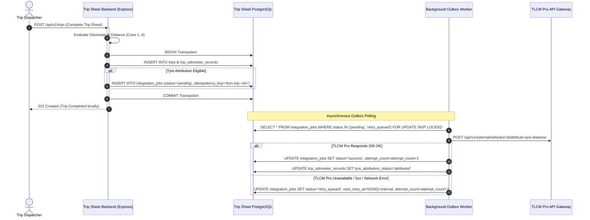

# TLCM Pro Integration Design

## 1. System Integration Boundaries & Authority

* **Authoritative Ownership**:
  * **TLCM Pro System**: Authoritative for Vehicle Master (`tlcm_vehicle_id`, registration, make/model, tonnage), Tyre Master, Axle Wheel Positions, Tyre Mount/Demount History, Vehicle Master Odometers, and Tyre Cumulative Lifecycle Distance.
  * **Trip Sheet System**: Authoritative for Driver Master, Driver Advances, Bunkering Fuel Top-Ups, Trip Sheets, Route Segments, Trip Fuel Balance, Trip Expense Audits, and Driver Payroll.
* **Database Isolation Principle**:
  * **Zero Cross-Database Writes**: The Trip Sheet backend connects strictly to its own PostgreSQL database. It **never** writes directly to or reads directly from the TLCM Pro database.
  * All communication is strictly mediated via the **TLCM Pro Backend REST API Gateway**.

---

## 2. Asynchronous Durable Outbox Pattern

To prevent network outages in TLCM Pro from blocking local trip sheet operations:



---

## 3. Idempotency & Tyre Attribution Rules

### 3.1 Idempotency Guarantee
* Every external request payload generates a deterministic **Idempotency Key**:
  $$\text{IdempotencyKey} = \text{MD5}(\text{JobType} + \text{TripId} + \text{VehicleId} + \text{AcceptedDistance})$$
* If an HTTP timeout occurs, the background worker retransmits the request with the identical `Idempotency-Key` header. TLCM Pro will acknowledge the duplicate without double-accumulating tyre distance.

### 3.2 Odometer Sequence Hold Policy (Rule 10 & 21)
* If `odometer_case === 'case_4_inconsistent_sequence'` (e.g. ending odo < starting odo, or starting odo < vehicle latest odo):
  1. `discrepancy_flag = true`
  2. `validation_status = 'discrepancy_held'`
  3. `tyre_attribution_eligible = false`
  4. `tyre_attribution_status = 'on_hold'`
  5. **No `IntegrationJob` is enqueued for tyre attribution.**
* Operational analytics still use reported distance, but tyre wear calculation remains completely paused until an auditor clears the discrepancy.

### 3.3 Stepney / Spare Tyre Exclusion (Rule 22)
* The Trip Sheet system specifies the target vehicle ID and accepted distance.
* The TLCM Pro API payload flags:
  ```json
  {
    "tripId": "uuid-trip-42",
    "tripNumber": "TRIP-2026-0042",
    "acceptedDistanceKm": 450,
    "startingOdometer": 125000,
    "endingOdometer": 125450,
    "excludeStepney": true
  }
  ```
* TLCM Pro attributes distance only to wheel positions currently installed on active driving/steering axles, strictly excluding the spare stepney tyre.

---

## 4. Retry Policy & Dead-Letter Handling

* **Retry Strategy**: Exponential backoff with jitter:
  $$T_{\text{retry}} = 2^{\text{attempt}} \times 60\text{ seconds} \pm \text{jitter}$$
  * Attempt 1: 1 minute
  * Attempt 2: 4 minutes
  * Attempt 3: 16 minutes
* **Dead-Letter Threshold**: After 3 consecutive failed attempts:
  * Job status transitions to `'failed'`.
  * Alerts appear on the frontend `TLCMIntegrationView.tsx` with red badge and manual "Retry" button.
  * Audit log is emitted with error details.

---

## 5. Unknowns & Questions Requiring TLCM Pro Team Confirmation

The following technical specifications cannot be inferred from the existing frontend and must be confirmed with the TLCM Pro engineering team:

1. **API Authentication Mechanism**: Is authentication handled via API Key header (`X-TLCM-API-Key`), Bearer JWT, or mutual TLS (mTLS)?
2. **Authoritative Endpoint Contract**: What is the exact path (`/api/v1/telemetry/odometer`, `/api/v2/vehicles/:id/distance`) and expected JSON request/response schema?
3. **Idempotency Header Convention**: Does TLCM Pro support `Idempotency-Key` or `X-Request-Id`?
4. **Stepney Handling**: Does TLCM Pro automatically filter spare tyres on its side when vehicle distance is pushed, or must the Trip Sheet system pass specific tyre serial numbers?
5. **Rate Limiting**: What are the rate limits (requests per minute) on the TLCM Pro gateway?
