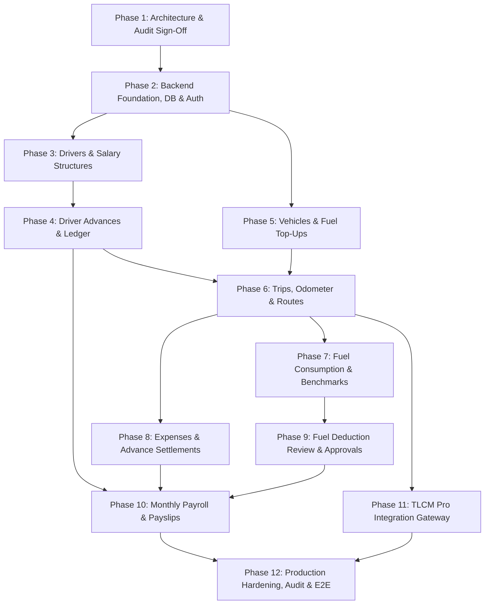

# Backend Implementation Roadmap

This 12-phase implementation roadmap defines the sequential engineering rollout for the Trip Sheet Management System backend, adhering strictly to real module dependencies discovered during the codebase audit.

---

## Phase Overview & Dependency Graph

---

## Detailed Phase Breakdown

### Phase 1: Repository Audit & Architecture Baseline *(Completed)*
* **Deliverables**: 16 Architecture Audit & Planning documents under `docs/architecture-audit/`.
* **Dependencies**: None.
* **Risks**: None (Read-only analysis).

### Phase 2: Backend Foundation, Database Configuration & Auth
* **Deliverables**:
  * Node.js + Express + TypeScript project scaffold in `backend/`.
  * Prisma ORM configuration, PostgreSQL connection pooling, initial base migration.
  * JWT Authentication service, password hashing, and RBAC middleware.
  * Structured logging (Pino) and global error handler middleware.
* **Database Models**: `users`, `refresh_tokens`, `audit_logs`, `system_settings`.
* **API Endpoints**: `POST /api/v1/auth/login`, `POST /api/v1/auth/refresh`, `GET /api/v1/auth/me`.
* **Acceptance Criteria**: Authenticated user can log in, receive a valid JWT, and hit a protected `/me` endpoint with RBAC validation.

### Phase 3: Driver Management & Salary Structures
* **Deliverables**:
  * Driver CRUD service and REST controllers.
  * Salary structure definition and versioned effective-dated assignment service.
* **Database Models**: `drivers`, `salary_structures`, `salary_components`, `driver_salary_assignments`.
* **API Endpoints**: `GET/POST /api/v1/drivers`, `GET /api/v1/drivers/:id`, `GET/POST /api/v1/salary-structures`, `POST /api/v1/salary-structures/:id/assign`.
* **Acceptance Criteria**: Unique driver numbers enforced; assigning a new salary structure archives the previous assignment with an `effective_to` timestamp.

### Phase 4: Driver Advances & Financial Ledger
* **Deliverables**:
  * Double-entry advance transaction service (debits and credits).
  * Real-time driver ledger aggregation service.
* **Database Models**: `driver_advance_transactions`.
* **API Endpoints**: `GET/POST /api/v1/advances`, `POST /api/v1/advances/:id/return`, `GET /api/v1/drivers/:id/ledger`.
* **Acceptance Criteria**: Issuing advance creates a debit record; cash returns create credit records; outstanding balance accurately reflects the net sum.

### Phase 5: Vehicle References & Fuel Top-Ups
* **Deliverables**:
  * Vehicle reference caching service (mirrored from TLCM Pro).
  * Fuel bunkering top-up service updating vehicle master odometers.
* **Database Models**: `vehicles`, `fuel_top_ups`.
* **API Endpoints**: `GET /api/v1/vehicles`, `GET/POST /api/v1/fuel-topups`.
* **Acceptance Criteria**: Logging top-up updates vehicle `latest_odometer` if higher than current; cost strictly equals litres × price.

### Phase 6: Trip Management, Route Segments & Odometer Validation
* **Deliverables**:
  * Trip creation and update service.
  * Server-side authoritative implementation of `evaluateOdometerAndDistance`.
  * Route segment management.
* **Database Models**: `trips`, `trip_odometer_records`, `trip_route_segments`.
* **API Endpoints**: `GET/POST /api/v1/trips`, `GET /api/v1/trips/:id`, `PATCH /api/v1/trips/:id`.
* **Acceptance Criteria**: Implements Cases 1, 2, 3, and 4; prevents sequence inversions; derives ending reading without fabricating measured values.

### Phase 7: Fuel Consumption, Mileage Benchmarks & Calculations
* **Deliverables**:
  * Trip fuel consumption balance validation (`calculateFuelConsumption`).
  * Mileage benchmark configuration service.
  * Potential fuel deduction calculator.
* **Database Models**: `trip_fuel_records`, `mileage_benchmarks`.
* **API Endpoints**: `GET/POST /api/v1/mileage-benchmarks`, `POST /api/v1/trips/:id/fuel`.
* **Acceptance Criteria**: Flags discrepancies > 5L between calculated balance and manual slips; computes mileage km/L accurately.

### Phase 8: Trip Expenses & Advance Settlement
* **Deliverables**:
  * Trip expense submission, approval, and rejection workflow.
  * Real-time advance reconciliation calculator (`calculateSettlementBalance`).
* **Database Models**: `trip_expenses`, `trip_settlement_records`.
* **API Endpoints**: `POST /api/v1/trips/:id/expenses`, `POST /api/v1/trips/:id/expenses/:expId/approve`, `POST /api/v1/trips/:id/expenses/:expId/reject`.
* **Acceptance Criteria**: Only approved expenses reduce the trip settlement balance; rejected expenses are excluded.

### Phase 9: Fuel Deduction Review & Audit Workflow
* **Deliverables**:
  * Potential fuel deduction review, waiver, and adjustment endpoints.
* **Database Models**: `trip_fuel_deductions`.
* **API Endpoints**: `GET /api/v1/fuel-deductions`, `POST /api/v1/fuel-deductions/:tripId/review`.
* **Acceptance Criteria**: Adjusting deduction amount requires a mandatory reason text; logs audit entry.

### Phase 10: Monthly Payroll & Payslip Generation
* **Deliverables**:
  * Payroll aggregation worker.
  * Immutability sealing and finalization service.
  * Printable payslip data service.
* **Database Models**: `payroll_runs`, `payroll_records`, `payroll_line_items`.
* **API Endpoints**: `POST /api/v1/payroll/runs/generate`, `POST /api/v1/payroll/runs/:id/finalize`, `GET /api/v1/payroll/runs/:id/payslips/:driverId`.
* **Acceptance Criteria**: Re-running draft aggregates approved fuel deductions and authorized advance recoveries; finalized runs are permanently sealed and immutable.

### Phase 11: TLCM Pro Integration Gateway
* **Deliverables**:
  * Durable Outbox background queue worker (Pg-Boss).
  * External TLCM Pro HTTP client with retries, exponential backoff, and idempotency keys.
  * Tyre attribution pusher excluding Stepney tyres.
* **Database Models**: `integration_jobs`.
* **API Endpoints**: `GET /api/v1/integrations/tlcm/jobs`, `POST /api/v1/integrations/tlcm/jobs/:id/retry`.
* **Acceptance Criteria**: Discrepant trips are held; external failure retries up to 3 times before dead-lettering; Stepney spare tyre excluded.

### Phase 12: Production Hardening, Audit Trail & Deployment
* **Deliverables**:
  * Full E2E Playwright test suite.
  * Read-only audit log viewer endpoints.
  * Docker containerization (`Dockerfile`, `docker-compose.yml`).
  * OpenAPI / Swagger documentation (`/api/docs`).
* **Acceptance Criteria**: 100% test pass rate across financial ledger, immutability, and TLCM retry suites.
